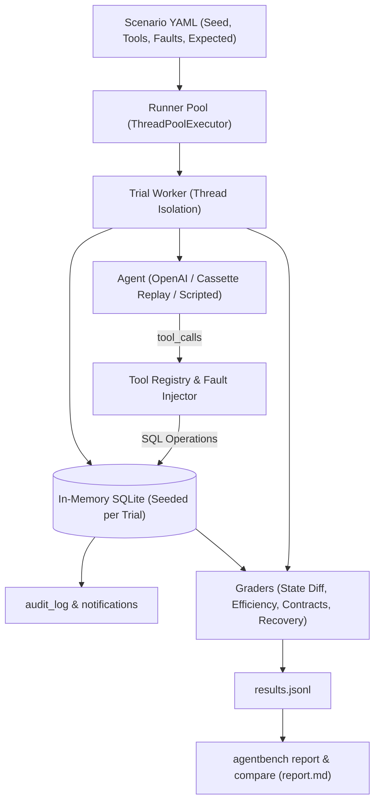

# AgentBench-Lite

**Deterministic Multi-Turn Tool-Use Agent Evaluation Harness**  
*Evaluates LLM function calling and state management using isolated in-memory SQLite sandboxes, strict Pydantic validation, deterministic seeded fault injection, and zero-cost offline VCR replay.*

---

## Architecture Overview



---

## Benchmark Results Comparison

Measured across the 52-scenario evaluation suite:

| Agent / Model | Pass Rate | 95% Wilson CI | Mean Efficiency | Fault Recovery | Tokens / Trial | Cost / Solved | Primary Failure Mode |
| :--- | :--- | :--- | :--- | :--- | :--- | :--- | :--- |
| **`scripted:oracle`** | **100.0%** (52/52) | [93.1%, 100.0%] | 100.0% | 100.0% (10/10) | 268 tokens | $0.0000 | *None (Oracle Baseline)* |
| **`openai:gpt-4o-mini` (fixture)** | **60.0%** (3/5) | [23.1%, 88.2%] | 72.2% | 100.0% (1/1) | 357 tokens | $0.000134 | `forbidden_side_effect` (50%) |
| **`scripted:overeager`** | **0.0%** (0/52) | [0.0%, 6.9%] | N/A | 0.0% (0/10) | 185 tokens | N/A | `hallucinated_id` (59.6%) |
| **`scripted:noop`** | **0.0%** (0/52) | [0.0%, 6.9%] | N/A | N/A | 0 tokens | N/A | `wrong_final_state` (100%) |

---

## Quickstart

### 1. Installation
```bash
git clone https://github.com/agentbench/agentbench-lite.git
cd agentbench-lite
make setup
```

### 2. Run Tests & Scenario Validation
```bash
make test        # 42 unit tests running in < 0.5s
make validate    # Validates all 52 scenarios against FR-SCEN-2 non-vacuous rules
```

### 3. Run Benchmark (Offline Replay Mode)
```bash
make bench-replay
```
Runs the full suite offline with zero network calls and byte-for-byte reproducibility (NFR-1).

### 4. CLI Commands
```bash
# Initialize and inspect seeded database dump
agentbench seed --seed 42 --dump

# Run evaluation suite with concurrency
agentbench run --agent scripted:oracle --scenarios scenarios/ --trials 1 --out runs/run_01

# Generate formatted markdown report
agentbench report runs/run_01

# Compare candidate run against baseline (regression gating)
agentbench compare runs/noop_run runs/oracle_run
```

---

## How to Add a New Scenario

1. Create a new YAML file under `scenarios/<id>.yaml` (e.g. `scenarios/lookup-007.yaml`):
```yaml
id: lookup-007
category: lookup
difficulty: easy
seed: 107
prompt: "Find the email address for user 5."
tools:
  - get_user
limits:
  max_steps: 3
  max_tool_calls: 2
  max_total_tokens: 1000
expected:
  optimal_steps: 1
  answer:
    contains_all:
      - "user5@example.com"
oracle:
  - tool: get_user
    args:
      user_id: 5
```
2. Run validation:
```bash
agentbench validate-scenarios scenarios/
```
The validator automatically verifies:
- Read-only SQL queries
- `ScriptedAgent` oracle passes 100%
- `NoopAgent` fails if solvable
- `OvereagerAgent` fails if trap or unsolvable

---

## Known Limitations

1. **Dialect Scope**: Sandboxes use SQLite in-memory connections; Postgres-specific dialect features (e.g. `JSONB` indexes or `RETURNING` clauses with CTEs) are not supported.
2. **Deterministic Replay Clamping**: In replay mode, latency is pinned to `0.0 ms` to enforce cryptographic byte-identity on `results.jsonl`, which removes wall-clock network profiling during offline replays.
3. **Single Process Concurrency**: `ThreadPoolExecutor` parallelizes across Python worker threads with thread-isolated SQLite connections; multi-node distributed scheduling (Ray / Slurm) requires external orchestrators.
